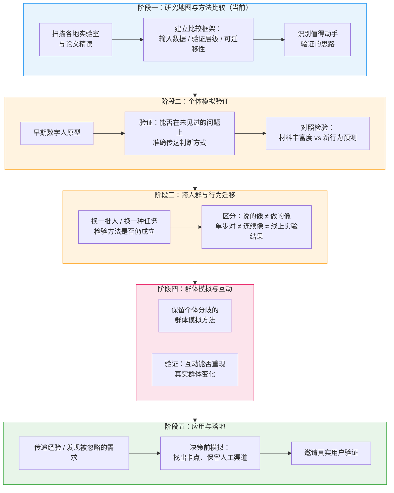

## 我们的愿景

我们希望探索：**让 AI 更准确地模拟具体的人和真实的群体，能否为人类带来更大的福祉？**

AI 已经越来越会像人一样说话。我们感兴趣的是更难的一步：它能不能保留一个人判断事情的方式？比如，一位老师面对学生的两种解法，会先注意到什么，又会因为什么改变判断？到了群体层面，问题不再是把许多个体放在一起，而是能不能保留不同处境的人之间的分歧，以及他们如何在互动中彼此影响。

模拟本身不是终点。我们想知道它能不能帮助人传递经验、发现被忽略的需求，或在真实决策之前看见原本没想到的后果。比如，一项公共服务改到线上之前，能否先用模拟找出哪些人可能卡在第一步、哪些地方值得保留人工渠道，再请真实用户验证？有用的模拟不替人发言，而是帮助我们更早发现应该去问谁、验证什么。

## 世界各地的研究走到了哪里

这个领域已经有不少扎实的局部成果，但它们回答的不是同一个问题。有人检验 AI 能不能答得像某位受访者，有人看它能不能复现一群人的选择，还有人研究群体如何在互动中形成惯例。把这些工作放在一起，重要的不只是用了什么模型，而是**用了什么现实数据、在哪一层做验证、换个场景以后结论还剩多少**。

- **美国｜更丰富的个人材料，能改善哪些预测？** [Park 等人的研究](https://arxiv.org/abs/2411.10109v4)对 1,052 位美国成年人做了约两小时的访谈。预测未提供给模型的社会调查答案时，仅用人口属性的匹配率为 60.4%，结合访谈与问卷材料后为 72.8%；真人两周后重答的一致率是 79.5%。但材料变丰富，并没有改善对带真实激励的经济选择的预测。**更了解一个人怎么说，不一定更能预测他怎么做。**
- **中国｜从一次问答走向连续行为。** [UserArena](https://arxiv.org/abs/2610.30932)用 11,010 名电商用户的 64,729 条真实会话轨迹做基准，覆盖搜索、浏览、购买等多种动作，并用线上 A/B 实验结果检验部分离线评估。它把「单步选得对不对」「连续行为像不像」和「能否反映线上实验结果」拆开检验。能通过其中一关，不代表能通过另外两关。
- **法国｜群体比例对了，单次选择也会对吗？** [图卢兹出行研究](https://arxiv.org/html/2610.22407v1#S4.SS5)发现，调过提示词的智能体能把总体出行方式分布做到接近传统模型；但看模型给每次实际出行方式分配的平均概率，仍不如「有车可开就开车」这条简单规则。**同一个模拟可以在总体上像，在个体层面却不够准。**
- **日本｜群体差异一定要预先写进画像吗？** [东京大学的团队](https://www.mdpi.com/1099-4300/26/12/1092)让一组没有预设性格和初始记忆的智能体在网格中反复交流。改变消息能传多远，会影响交流习惯和行为差异的形成。这提供了一种研究群体互动的实验方法，但观察到的现象发生在模拟环境里，不能直接当作真实人群也会如此的证据。
- **跨地区｜把国籍写进提示词，能代表当地人吗？** [覆盖 74 国的经济偏好研究](https://www.nature.com/articles/s41562-026-02611-4)发现，在其测试设定下，模型预测平均只解释了真人经济偏好约 1.3% 的个体差异、4.2% 的国家层面差异。[另一项覆盖 64 国的生活满意度研究](https://www.pnas.org/doi/10.1073/pnas.2519394122)发现，模型在埃塞俄比亚、津巴布韦、尼日利亚和肯尼亚等地高估了受访者的生活满意度。这类误差不只是让总体数字偏一点，还可能让我们看不见原本最需要被听见的人。

这些结果放在一起，指向三个还没连起来的问题：**个人材料能否帮助预测新行为，局部验证过的方法能否迁移到另一人群，个体之间的互动能否重现真实群体的变化。** 我们不打算用一个「像人」的分数把它们合在一起。

## 我们走到了哪里

**目前，我们正在做研究地图和方法比较。** 我们沿着不同地区的实验室、会议和研究社群找工作，再把回答同一个问题的论文放在一起精读：模型看到了什么，用什么真人数据对照，有没有和简单方法比过，换一批人或换一种任务还能不能成立。我们想从中找到值得动手验证的思路，而不是只整理一份论文清单。

我们也已经做过一个早期数字人原型。材料由一位老师主动提供，**他本人和熟悉他的人**都给出了积极反馈。这是有价值的初步反馈，但还没有验证原型能否在没见过的问题上准确传达他的判断，也不意味着群体模拟已经进入验证阶段。

## 主题与许可

本站基于 [Clarity / blog-v3](https://github.com/L33Z22L11/blog-v3) 构建，主题作者为 L33Z22L11（纸鹿）。代码遵循上游 MIT 许可，并保留原始版权声明。本站未转载原作者文章。

[本站源码](https://github.com/Ashripa/research-journal)
