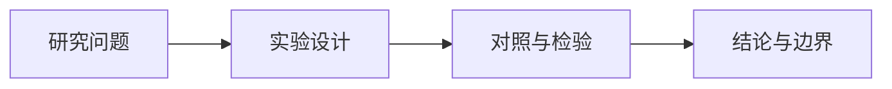

这是一篇独立的**样式样本**，用于挑选文章的呈现方式。以下均调用当前主题已有组件，不新增或覆盖组件样式；示例文字不代表真实论文实验结果。源码采用 Nuxt Content 的 **MDC**，不是 React MDX。

先看实际效果，再看附近的调用方式。组件可组合，但并非每一种都适合论文简报。主题的正文、字号和脚注沿用本站当前配置；其中脚注悬停内容预览是本站已有增强，并非上游原生功能。

## 1. 普通 Markdown 排版

### 三级标题：小节

正文段落，包含中文、English 与数字 2026。**粗体强调**、*斜体强调*、~~删除文字~~、`inline code`，以及[主题源码](https://github.com/L33Z22L11/blog-v3)。

#### 四级标题：更细一层

##### 五级标题

###### 六级标题

标题不必层层套用。论文简报宜少用深层标题，避免留白和缩进不断增加。

- 无序列表第一项
- 第二项，包含子列表
  - 子项 A
  - 子项 B

1. 有序步骤：先定义问题。
2. 再设计对照。
3. 最后报告证据边界。

- [x] 已完成的任务（静态示例）
- [ ] 尚未完成的任务

> 普通引用块：适合摘录、说明与短判断。
>
> 可以容纳多个段落，不需要引入专门组件。

下面展示分隔线的原有样式。

---

### 表格 · ProseTable

| 呈现方式 | 适合内容 | 注意事项 |
| :--- | :--- | :--- |
| 正文与脚注 | 深入阅读 | 不必把所有内容装进卡片 |
| CardList | 并列短信息 | 多段长文会让卡片变高 |
| Folding | 次要细节 | 读者需要主动展开 |

表格沿用已有组件，可悬停查看换行／横向滚动切换。

### 脚注 · ProseA

正文中的脚注入口[^sample]，以及第二条多段注释[^long-note]。点击数字跳到文末，返回箭头回到正文；悬停预览沿用本站现有行为。

### 代码 · ProseCode / ProsePre

行内代码：`const evidence = "example"`。

```python
# 仅作代码排版示例，不运行任何外部请求。
def summarize(paper):
    return {
        "question": paper["question"],
        "evidence": paper["evidence"],
    }
```

### 数学公式

行内公式 $E = mc^2$。独立公式由当前 KaTeX 配置渲染：

$$
\bar{x} = \frac{1}{n}\sum_{i=1}^{n}x_i
$$

## 2. 紧凑卡片 · CardList

直接把 Markdown 列表包在 `::card-list` 中。以下第一组是一篇论文的三个信息块：

::card-list
- **研究问题**  
  比较模型模拟与真人观测，究竟对齐了什么？
- **实验方法**  
  先设置基线，再检查误差与外推边界。
- **关键判断**  
  表面相似不等于结构一致，指标必须与用途对应。
::

### 多段卡片：能力与限制

CardList 也能容纳列表项中的多段文字和子列表，只需保持缩进；它不会自动理解或排版“作者、方法、结果”等字段。下面故意放入不同长度内容，观察原生网格的高度与留白。

::card-list
- **示例论文 A**

  这是第一段摘要。多段内容仍然属于同一个列表项，也就属于同一张卡片。

  这是第二段，补充证据边界。

  - 方法：一个简短基线。
  - 结论：保留限制条件。

- **示例论文 B**

  这张卡片更短，展示同一行卡片在不同内容量下的效果。
::

```md
::card-list
- **论文 A**

  第一段。

  第二段。

- **论文 B**

  一句摘要。
::
```

原生卡片有背景、圆角和阴影，不是“只在悬停时有底色”的 ghost 卡片；此处没有替它改样式。

## 3. 链接卡片 · LinkCard / LinkBanner

### LinkCard：轻量原文入口

::link-card{title="Clarity 主题源码" description="代码仓库 · L33Z22L11/blog-v3" link="https://github.com/L33Z22L11/blog-v3"}
::

标题最多显示两行，描述单行省略。它适合链接入口，不适合承载完整论文简报。

```md
::link-card{title="论文标题" description="作者 · 会议 · 年份" link="https://example.com/paper"}
::
```

### LinkBanner：带封面的入口

::link-banner{title="研究日志" description="较醒目的入口，适合专题而非密集论文列表。" link="/" banner="/research-journal/style-gallery/sample.svg"}
::

## 4. 折叠细节 · Folding

::folding{title="展开：实验步骤与边界"}
1. 准备参照数据。
2. 设置对照实验。
3. 检查群体误差与迁移效果。

**限制**：本段只是排版示例，没有真实实验数值。
::

```md
::folding{title="实验细节"}
这里可以写段落、列表、公式或链接。
::
```

## 5. 提示框 · Alert

主题提供五类语义和卡片／扁平两种外观，下面全部实际展示。

::alert{type="tip" title="提示 · 默认卡片"}
用于补充阅读提示。
::

::alert{type="info" title="信息"}
用于研究背景、术语或说明。
::

::alert{type="question" title="问题"}
这项实验是否真的回答了用户关心的问题？
::

::alert{type="warning" title="限制"}
不要把群体分布拟合等同于个人行为预测准确。
::

::alert{type="error" title="错误示例"}
这是错误提示的外观演示，并不表示页面发生故障。
::

::alert{type="info" title="扁平样式 · 锐评" flat}
已有 `flat` 选项，不需要另写 CSS。适合放一句有依据的专业判断。
::

## 6. 行内标签与交互

### Badge：文字与链接标签

:badge{ text="ACL" } :badge{ text="2026" } :badge{ text="问卷模拟" round } :badge{ text="主题源码" link="https://github.com/L33Z22L11/blog-v3" }

### Tip：悬停提示与复制

把鼠标或键盘焦点移到 :tip[术语提示]{tip="这里是完整解释，沿用主题已有气泡。"}。

点击 :tip[example-paper-id]{copy} 可复制这段示例文本。

### Blur：模糊文字

这是 :blur[悬停后清晰的文字]。它只是视觉效果，不是保密机制，也不适合放重要且必须触屏可读的信息。

### Key：按键标记

:key{code="Enter"} :key{code="k" ctrl} :key{code="Escape"}

仅展示按键外观，不注册会改变页面内容的操作。

### EmojiClock：时间标记

固定时间 :emoji-clock{datetime="2026-11-17T09:30:00+08:00"}，旋转指针样式 :emoji-clock{datetime="2026-11-17T09:40:00+08:00" rotate}。

### Copy：可编辑的单行复制框

::copy{prompt="$" code="echo 'Clarity component demo'" lang="bash"}
::

可在框内改字、复制或恢复；这里只是文字，不会执行命令。

## 7. 页签 · Tab

::tab{:tabs='["概览", "实验", "局限"]'}
#tab1
简短概览放在第一张页签。页签会隐藏其他部分，不适合必须一眼看全的内容。

#tab2
1. 准备参照。
2. 运行对照。
3. 比较结果。

#tab3
模型指标不等于真实部署表现。
::

## 8. 次级标题与引言

### MdTitle：不进入标题层级的小标题

::md-title
一条视觉小标题
::

它不是 Markdown 的 `h2/h3`，适合局部标记。

### Quote：醒目的短引言

::quote
先问证据证明了什么，再问模型有多像人。
::

### Poetry：诗句与短文

::poetry{title="阅读之间" author="本页演示短句" footer="仅用于展示排版"}
翻过一页，留下一问。  
读到深处，再看证据。
::

## 9. 时间线 · Timeline

::timeline
{提出问题}

明确目标与评价指标。

{设计实验}

建立基线，记录变量。

{复盘结果}

写清结论，也写清不能推出什么。
::

## 10. 对话 · Chat

::chat
{研究者}

这个指标足以支持结论吗？

{.读者}

还需要看对照和适用边界。

{:以下为排版示例，不是真实对话记录}
::

## 11. 图片 · Markdown / Pic

普通 Markdown 图片：


Pic 增加图注及点击放大：

::pic{src="/research-journal/style-gallery/sample.svg" caption="Pic 图注：点击图片可查看主题现有放大交互。"}
::

## 12. 流程图 · Mermaid



由主题已有代码块转换插件调用 Mermaid；图形在客户端渲染。

## 13. 乐谱 · MusicScore

```music-abc
X:1
T:Component Demo
M:4/4
L:1/4
K:C
C D E F | G A B c | c B A G | F E D C |]
```

展示 ABC 乐谱排版。声音播放依赖外部音色库的可达性；无法访问时不影响静态乐谱的用途。

## 14. 视频 · VideoEmbed

::video-embed{type="raw" id="/research-journal/style-gallery/sample.mp4" poster="/research-journal/style-gallery/sample.svg" ratio="16 / 9" width="640px"}
::

这是本页生成的三秒无声几何视频，不自动播放。主题还支持 B 站、YouTube、抖音、TikTok 嵌入；它们是同一组件的不同来源配置，依赖第三方播放器、网络及视频的嵌入许可。本页不额外加载这些外站播放器。

## 15. 友链卡片 · FeedCard / FeedGroup

这些组件为站点／作者友链设计，不是论文元数据卡。以下使用本站公开信息作为样本。

::feed-card{author="研究日志" sitenick="本站示例" title="研究日志" desc="友链卡片的悬停说明。" link="https://ashripa.github.io/research-journal/" feed="https://ashripa.github.io/research-journal/atom.xml" icon="/research-journal/avatar.svg" avatar="/research-journal/avatar.svg" date="2026-11-17"}
::

::feed-group
---
name: 示例分组
desc: 分组标题与友链布局，不建议拿来装论文摘要。
entries:
  - author: 研究日志
    sitenick: 本站
    desc: 本站公开入口，用于展示分组卡片。
    link: https://ashripa.github.io/research-journal/
    feed: https://ashripa.github.io/research-journal/atom.xml
    icon: /research-journal/avatar.svg
    avatar: /research-journal/avatar.svg
    date: '2026-11-17'
---
::

## 16. 实例与语法并排切换 · Demo

Demo 是主题现有的“组件／语法”展示器。下面通过 `demo` 代码块调用：

```demo
::alert{type="info" title="这是实际组件" flat}
切到“语法”页签，可查看这一块的源码。
::
```

## 17. 一篇论文的组合示例

以下不新增 PaperCard，只组合主题现成能力。

::md-title
示例研究：从边际分布到结构检验
::

:badge{text="方法研究"} :badge{text="示例 · 非真实论文"}

::card-list
- **回应问题**  
  单题比例一致，是否意味着题间结构也一致？
- **实验方法**  
  分别检查分布、相关结构和群体误差。
- **关键判断**  
  必须用与目标相符的指标检验，不能只看一个总分。
::

::folding{title="展开实验细节"}
1. 先明确可观测目标。
2. 使用相同数据预算比较基线。
3. 报告留出测试与失败情况。
::

::alert{type="info" title="锐评" flat}
紧凑排版应压缩重复信息，不应压缩证据与边界。
::

## 18. 覆盖清单与选择建议

本页覆盖内容目录中的 28 个组件：Alert、Badge、Blur、CardList、Chat、Copy、Demo、EmojiClock、FeedCard、FeedGroup、Folding、Key、LinkBanner、LinkCard、MdTitle、Mermaid、MusicScore、Pic、Poetry、ProseA、ProseCode、ProsePre、ProseTable、Quote、Tab、Timeline、Tip、VideoEmbed。其中 Prose 系列通过普通 Markdown 自动使用，不需要手写组件名。

普通 Markdown 另展示标题、强调、列表、任务列表、引用、分隔线、图片、链接、表格、代码、脚注与公式。技术文章样式为本页当前样式；主题另有整篇 `story` 文章类型，不在同一篇中强行覆盖或混用。

**选择建议**：论文速览优先 CardList，详细论证保留正文与脚注，次要细节放 Folding。LinkCard 用于原文入口，Badge 用于短标签。并不需要把每个段落都变成组件。

[^sample]: 这是第一条注释，展示默认返回箭头。

[^long-note]: 第一段注释，解释一个限定条件。

    第二段注释，提醒读者不要过度外推。
